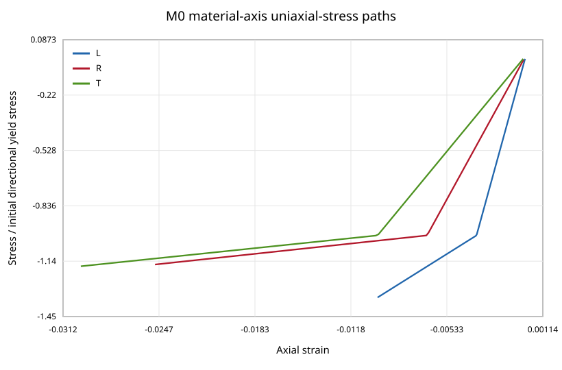

# 木材用Hill型異方性材料点ソルバー / Hill-Type Orthotropic Material-Point Solver for Wood

This repository is a **validated-prototype** reference implementation of one deliberately narrow constitutive model:

- small-strain orthotropic elasticity in material axes L/R/T;
- Hill's quadratic, pressure-insensitive yield surface;
- associated plastic flow;
- linear isotropic hardening;
- fully implicit backward-Euler return mapping;
- a Jacobian-consistent algorithmic tangent independently checked by central finite differences.

It is an algorithm-verification project, **not material calibration** and **not an engineering safety model**. M1 tension/compression asymmetry, M2 densification history, M3 damage, finite elements, contact, Marc/HYPELA2 integration, screw insertion/withdrawal, and reproduction of Xu et al.'s embedment model are not implemented.



## Verified outcome

Using the explicitly invented demonstration parameters in [`parameters/demo_wood.json`](parameters/demo_wood.json):

| Check | Result |
|---|---:|
| Maximum plastic yield residual | `1.46e-10 MPa` |
| Maximum scaled Newton residual | `3.65e-12` |
| Maximum return iterations | `3` |
| Maximum tangent relative FD error | `3.93e-10` |
| 37° rotation stress covariance error | `7.11e-15 MPa` |
| 37° work-conjugacy error | `1.11e-16 MPa` |
| Non-proportional step-convergence order | `1.04` |
| Plastic dissipation increment minimum | `0.0 MPa` |
| Lateral stress maximum in L/R/T uniaxial drivers | `6.93e-11 MPa` |

The material-axis yield-onset stresses are approximately −40.09 MPa (L), −6.00 MPa (R), and −6.01 MPa (T); pure-shear onsets are 3.01, 4.00, and 4.50 MPa for RT, TL, and LR. These values only verify that the solver recovers its own declared input surface.

## Convention

The work-conjugate Voigt order is:

```text
stress = [sigma_LL, sigma_RR, sigma_TT, tau_RT, tau_TL, tau_LR]
strain = [eps_LL,   eps_RR,   eps_TT,   gamma_RT, gamma_TL, gamma_LR]
```

Stress shear components are physical shear stresses; strain shear components are engineering shear strains. Therefore `stress @ strain` equals the tensor double contraction and gives work density. The rotation API treats the columns of `Q` as material L/R/T basis vectors in global coordinates.

## Reproduce

The project requires Python 3.9+ and NumPy 2.0.2. It does not require SciPy, pytest, a compiler, or a commercial solver.

```sh
make all
```

This regenerates machine-readable paths, verification summaries, and original SVG figures, then runs the standard-library `unittest` suite. To run separately:

```sh
make analyze
make test
make check
```

## Repository map

- [`wood_hill/`](wood_hill): constitutive implementation, rotations, loading drivers, and extension contracts.
- [`REPORT.md`](REPORT.md): equations, numerical algorithm, verification evidence, interpretation, and limitations.
- [`DATA_CARD.md`](DATA_CARD.md): generated-data and disclosure card.
- [`PARAMETER_CARD.md`](PARAMETER_CARD.md): every demonstration value and its status.
- [`docs/HYPELA2_NEUTRAL_INTERFACE.md`](docs/HYPELA2_NEUTRAL_INTERFACE.md): solver-neutral state-vector mapping and pseudocode—not proprietary or compilable Marc code.
- [`results/summary.json`](results/summary.json): compact machine-readable acceptance record.
- [`results/loading_paths.csv`](results/loading_paths.csv): synthetic material-point histories.
- [`results/tangent_checks.csv`](results/tangent_checks.csv): analytic/finite-difference tangent comparison.
- [`provenance/SOURCE_AUDIT.md`](provenance/SOURCE_AUDIT.md): public method sources and disclosure boundary.

## Use boundary

Hill M0 is tension/compression symmetric and pressure-insensitive. Real wood is neither in general. The synthetic values are not tied to a species, grade, moisture content, temperature, strain rate, specimen geometry, or design standard. Do not use this prototype for structural design, safety assessment, failure prediction, or a claim that a timber connection or proprietary FE subroutine has been validated.

Code and original documentation are MIT-licensed. Cited publications are referenced but not redistributed.
