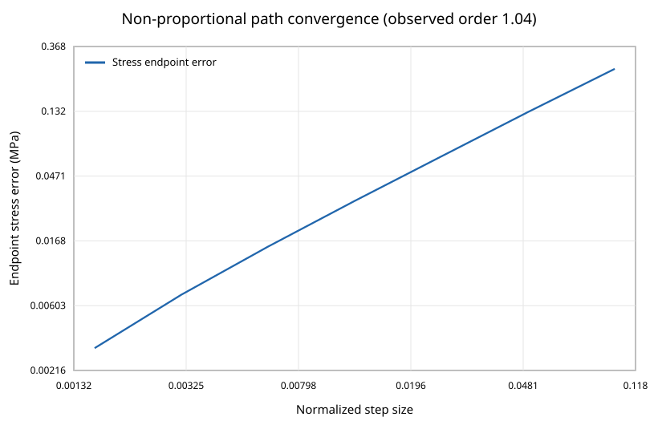

# 木材用Hill型異方性材料点ソルバー / Hill-Type Orthotropic Material-Point Solver for Wood

## Status and research question

The deliverable is a **validated-prototype** of an M0 material-point update. It asks a numerical question: can a small-strain orthotropic elastic, associated Hill-plastic model with linear isotropic hardening update stress and history robustly under arbitrary 3D strain increments, rotate consistently between global and material axes, and return an algorithmic tangent that matches an independent finite-difference derivative?

The answer is yes for the synthetic tests in this repository. This is **not material calibration**, not reproduction of an embedment finite-element study, and **not an engineering safety model**.

## Scope decision from the source audit

The project follows a staged public roadmap: M0 Hill plasticity, M1 tension/compression asymmetry, M2 densification history, and M3 damage, followed by solver and finite-element validation. This repository implements only M0 and cites primary literature directly; it does not reproduce third-party figures, tables, parameters, finite-element models, or validation claims.

Only M0 is implemented. No contact, fastener geometry, mesh, large deformation, failure, densification, damage, insertion, withdrawal, or commercial-solver call is present. M1/M2/M3 appear only as `not_implemented` contracts with required future verification gates.

## Kinematics, signs, and Voigt convention

The formulation is infinitesimal strain. Compression is negative in the loading examples. Material axes are longitudinal L, radial R, and tangential T. Voigt vectors are

\[
\boldsymbol\sigma_v=
[\sigma_{LL},\sigma_{RR},\sigma_{TT},\tau_{RT},\tau_{TL},\tau_{LR}]^T,
\]

\[
\boldsymbol\varepsilon_v=
[\varepsilon_{LL},\varepsilon_{RR},\varepsilon_{TT},\gamma_{RT},\gamma_{TL},\gamma_{LR}]^T.
\]

The stress vector uses physical shear and the strain vector uses engineering shear, so incremental work is exactly \(\boldsymbol\sigma_v^T d\boldsymbol\varepsilon_v\). This same convention is used for elastic stiffness, plastic strain, flow direction, rotation operators, tangents, and energy checks.

## Orthotropic elasticity

The compliance matrix uses the independent constants \(E_L,E_R,E_T,G_{RT},G_{TL},G_{LR},\nu_{LR},\nu_{LT},\nu_{RT}\). A ratio \(\nu_{ij}\) means lateral strain in \(j\) under uniaxial stress in \(i\). Reverse ratios are computed through

\[
\frac{\nu_{ij}}{E_i}=\frac{\nu_{ji}}{E_j}.
\]

The implementation constructs the symmetric compliance first, checks positive definiteness, and then inverts it. For the demonstration card, the compliance minimum eigenvalue is `8.13e-05 1/MPa`, the stiffness minimum eigenvalue is `55.0 MPa`, the stiffness condition number is `223.7`, and the maximum reciprocity error is `5.42e-20 1/MPa`. Invalid non-positive-definite parameter sets are rejected before integration.

## Hill surface and hardening

The equivalent stress is

\[
q(\boldsymbol\sigma)=\sqrt{\boldsymbol\sigma_v^T\mathbf A\boldsymbol\sigma_v},
\]

where \(\mathbf A\) is assembled from Hill coefficients \(F,G,H,L,M,N\). Given six directional initial yields \(X_L,Y_R,Z_T,S_{RT},S_{TL},S_{LR}\) and reference stress \(\sigma_0\), coefficients are normalized so each supplied directional stress gives \(q=\sigma_0\). For example,

\[
F=\frac{\sigma_0^2}{2}\left(Y_R^{-2}+Z_T^{-2}-X_L^{-2}\right),
\quad L=\frac{\sigma_0^2}{2S_{RT}^2},
\]

with cyclic counterparts. The code rejects a calibration if \(\mathbf A\) is not positive semidefinite. The hydrostatic vector is in the null space; M0 is pressure-insensitive.

The yield function and linear hardening law are

\[
f=q(\boldsymbol\sigma)-R(\kappa),\qquad
R(\kappa)=\sigma_0+H_{iso}\kappa.
\]

Associated flow and the chosen equivalent plastic history update are

\[
d\boldsymbol\varepsilon^p=d\lambda\,\mathbf n,
\quad \mathbf n=\frac{\partial q}{\partial\boldsymbol\sigma_v},
\quad d\kappa=d\lambda.
\]

Because \(q\) is homogeneous of degree one,

\[
dD_p=\boldsymbol\sigma_v^T d\boldsymbol\varepsilon_v^p
=d\lambda\,q\ge 0
\]

for an admissible plastic multiplier. Every generated step checks this quantity.

## Fully implicit return mapping

For a trial stress \(\boldsymbol\sigma^{tr}=\boldsymbol\sigma_n+\mathbf C\Delta\boldsymbol\varepsilon\), an elastic step is accepted when \(f^{tr}\) is within tolerance. A plastic step solves seven coupled backward-Euler equations for \(\boldsymbol\sigma_{n+1}\) and \(\Delta\lambda\):

\[
\mathbf r_\sigma=
\boldsymbol\sigma_{n+1}-\boldsymbol\sigma^{tr}
+\Delta\lambda\,\mathbf C\mathbf n(\boldsymbol\sigma_{n+1})=\mathbf0,
\]

\[
r_f=q(\boldsymbol\sigma_{n+1})-
[\sigma_0+H_{iso}(\kappa_n+\Delta\lambda)]=0.
\]

Newton iteration uses the exact residual Jacobian and a backtracking line search that prevents a negative plastic multiplier. The Hill Hessian is

\[
\frac{\partial\mathbf n}{\partial\boldsymbol\sigma_v}
=\frac{\mathbf A}{q}-\frac{(\mathbf A\boldsymbol\sigma_v)
(\mathbf A\boldsymbol\sigma_v)^T}{q^3}.
\]

The algorithmic tangent is not a continuum approximation. After convergence, the code differentiates these same discrete equations implicitly and solves the 7×7 Jacobian against \([\mathbf C;\mathbf0]\). A completely separate central finite-difference routine re-integrates from the unchanged old state for every tangent column.

## Demonstration parameters

Every numerical input is custom and uncalibrated. The values were selected to exercise strong orthotropy while preserving positive-definite elasticity and a convex Hill surface.

| Quantity | Value (MPa unless dimensionless) |
|---|---:|
| \(E_L,E_R,E_T\) | 12000, 900, 600 |
| \(G_{RT},G_{TL},G_{LR}\) | 55, 650, 750 |
| \(\nu_{LR},\nu_{LT},\nu_{RT}\) | 0.35, 0.40, 0.30 |
| \(X_L,Y_R,Z_T\) | 40, 6, 6 |
| \(S_{RT},S_{TL},S_{LR}\) | 3, 4, 4.5 |
| \(H_{iso}\) | 2500 |

They are not Xu et al. values, not a timber grade, and not a recommended calibration. Equal R/T yield values do not imply that radial and tangential wood behavior is generally equal; the demonstration retains different R/T stiffnesses.

## Verification protocol and results

### Directional and shear recovery

L/R/T tests impose axial strain while a nested Newton solve chooses the two lateral strain increments that make lateral stresses zero. Maximum residual lateral stress is `6.93e-11 MPa`.

| Path | Initial input yield (MPa) | Detected onset (MPa) | Final strain | Final stress (MPa) |
|---|---:|---:|---:|---:|
| L uniaxial | −40.0 | −40.086 | −0.010 | −53.793 |
| R uniaxial | −6.0 | −6.003 | −0.025 | −6.971 |
| T uniaxial | −6.0 | −6.006 | −0.030 | −7.029 |
| RT pure shear | 3.0 | 3.005 | 0.080 | 3.285 |
| TL pure shear | 4.0 | 4.002 | 0.025 | 4.454 |
| LR pure shear | 4.5 | 4.502 | 0.022 | 4.986 |

Onset differences reflect the finite reporting increment; direct Hill calibration errors are at or below `1.42e-14 MPa`.

### Return consistency and tangent

Across all monotonic and cyclic verification paths, the maximum absolute plastic yield residual is `1.46e-10 MPa`, maximum scaled Newton residual is `3.65e-12`, and the solver uses at most three Newton iterations.

| Tangent case | Branch | Relative Frobenius error vs central FD | Maximum absolute difference (MPa) |
|---|---|---:|---:|
| Origin, small increment | elastic | `2.96e-14` | `3.39e-10` |
| Origin, mixed plastic increment | plastic | `1.20e-11` | `6.23e-08` |
| Preloaded plastic state | plastic | `1.19e-11` | `7.18e-08` |
| 37° rotated global update | plastic | `3.93e-10` | `5.97e-07` |

The perturbation is `1e-8` engineering strain. All checked analytic tangents are symmetric to `1.14e-13 MPa` or better and have positive minimum eigenvalues for these hardening cases.

### Rotation

A mixed plastic increment is applied once in material axes and once after rotating L/R by 37° in the global plane. Material stress covariance and the independently transformed global stress each agree within `7.11e-15 MPa`. Global/material incremental work differs by `1.11e-16 MPa`. This checks both the tensor rotation and the engineering-shear transformation matrices.

### Load–unload–reload and energy

The R-axis path loads to −0.025 strain, unloads to −0.013, and reloads to −0.030. All 60 unload steps are elastic; \(\kappa\) is exactly unchanged (`0.002588235294115864`) during that segment and increases on renewed plastic loading. Across every recorded path, the minimum plastic-dissipation increment is zero, never negative; stored elastic energy is also non-negative.

This check does not validate cyclic wood behavior. M0 has no kinematic hardening, stiffness degradation, hysteretic damage, or tension/compression asymmetry.

### Step-size convergence

A non-proportional six-component path is integrated with 10–640 equal pseudo-time steps and compared with a 2,560-step reference. Endpoint stress error falls from `0.2580 MPa` to `0.00307 MPa`, a factor of 83.9. A log–log fit over the interior levels gives order `1.043`, consistent with first-order backward Euler.

## M1/M2/M3 roadmap—not implemented

| Stage | Proposed change | Required gates before a validated claim |
|---|---|---|
| M1 | tension/compression-asymmetric yield surface | independent L/R/T tensile and compressive calibration, convexity, reversal, tangent checks |
| M2 | densification history and possibly evolving stiffness | transverse compression/unloading evidence, thermodynamic check for evolving stiffness, insertion-to-withdrawal state transfer |
| M3 | directional damage variables | fracture-energy or objective regularization, mesh sensitivity, independent crack/full-field validation |

These are interface contracts only. No equation in this repository updates those proposed variables.

## HYPELA2-neutral handoff

[`docs/HYPELA2_NEUTRAL_INTERFACE.md`](docs/HYPELA2_NEUTRAL_INTERFACE.md) maps M0 state to a solver-neutral vector and gives pseudocode. It deliberately avoids a proprietary function signature, manual text, or copied source. A real commercial-solver port must independently verify component ordering, rotation ownership, finite-strain flags, state initialization, tangent convention, time stepping, and host-level Newton convergence.

## Limitations and prohibited inference

- Small strain is assumed even when demonstration strains are deliberately large enough to exercise plasticity.
- Hill M0 is pressure-insensitive and tension/compression symmetric; wood generally exhibits pressure, sign, moisture, rate, and species effects.
- Isotropic hardening expands every direction together and cannot independently match L/R/T/shear hardening.
- The tests are material-point verification, not experimental validation.
- There is no FE mesh, geometry, boundary condition, contact, friction, fastener, densification, fracture, or localization.
- No Marc/HYPELA2 subroutine has been compiled or run.
- No published curve, figure, table, or proprietary code is reproduced.
- Results must not be used for design values, safety factors, structural capacity, or claims about a real timber product.

## Reproduction

Run `make all` from the project root. It regenerates all CSV/JSON/SVG artifacts and executes the tests. The machine acceptance record is [`results/summary.json`](results/summary.json); full paths are in [`results/loading_paths.csv`](results/loading_paths.csv), and file hashes are in [`results/artifact_manifest.csv`](results/artifact_manifest.csv).

## Primary references

1. Hill, R. (1948). “A theory of the yielding and plastic flow of anisotropic metals.” *Proceedings of the Royal Society A*, 193, 281–297. <https://doi.org/10.1098/rspa.1948.0045>
2. Simo, J. C., & Taylor, R. L. (1985). “Consistent tangent operators for rate-independent elastoplasticity.” *Computer Methods in Applied Mechanics and Engineering*, 48(1), 101–118. <https://doi.org/10.1016/0045-7825(85)90070-2>
3. Xu, B.-H., Bouchaïr, A., Taazount, M., & Racher, P. (2013). “Numerical simulation of embedding strength of glued laminated timber for dowel-type fasteners.” *Journal of Wood Science*, 59, 17–23. <https://doi.org/10.1007/s10086-012-1296-0>
4. Oudjene, M., & Khelifa, M. (2009). “Elasto-plastic constitutive law for wood behaviour under compressive loadings.” *Construction and Building Materials*, 23(11), 3359–3366. <https://doi.org/10.1016/j.conbuildmat.2009.06.034>

Hill and Simo–Taylor ground the mathematical choices. Xu et al. and Oudjene–Khelifa explain the wood-mechanics research context and later densification need; this prototype does not reproduce their models or parameters.
